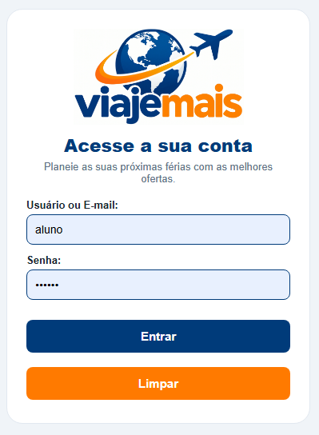
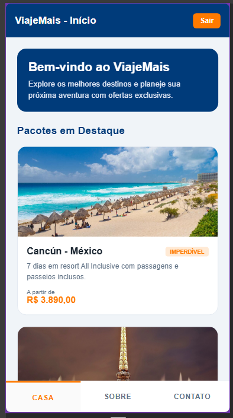
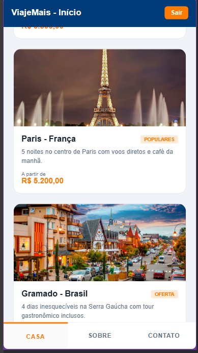
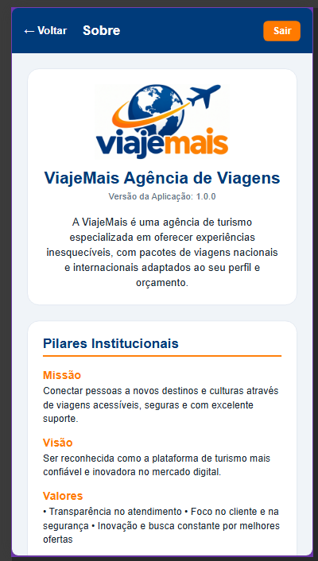
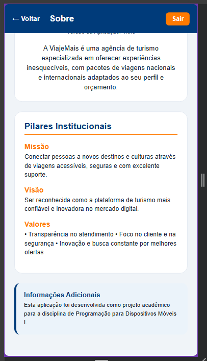
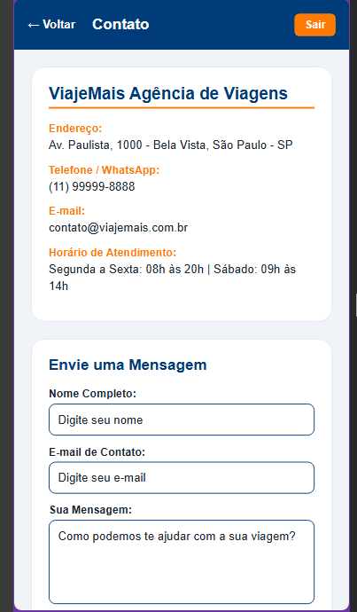
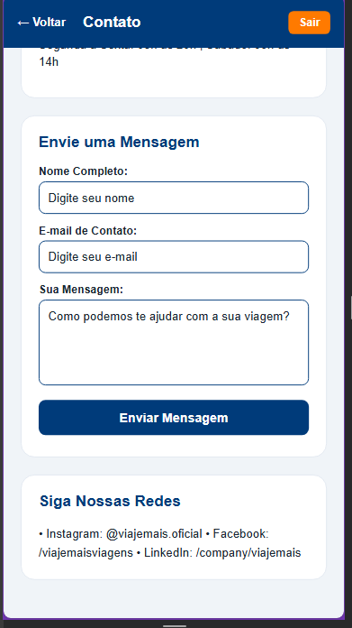

AgenciaDeViagens - ViajeMais

Nome: Ana carolina Vieira Santos

Nome da Aplicação
CREDENCIAIS: EMAIL/USUÁRIO: aluno
             SENHA: 123456  
ViajeMais - Agência de Viagens

Descrição Resumida
O ViajeMais é um aplicativo mobile desenvolvido para uma agência de turismo fictícia. A aplicação permite ao usuário realizar autenticação de acesso, navegar por destinos em destaque na tela inicial, conhecer os pilares institucionais da empresa e entrar em contato direto com a equipe de suporte através de formulários e canais de atendimento.

Tecnologia e Frameworks Utilizados
React Native (Interface de usuário)

Expo (Ambiente de desenvolvimento e bundling)

JavaScript (ES6+)

StyleSheet Module (Estilização nativa modularizada)

Instruções para Executar o Projeto
Clonar o repositório:

Bash
git clone https://github.com/c44rolina/AgenciaDeViagens.git
Acessar a pasta do projeto:

Bash
cd AgenciaDeViagens
Instalar as dependências:

Bash
npm install
Executar a aplicação com Expo:

Bash
npx expo start -c
Visualizar no navegador ou dispositivo:

Pressione w no terminal para abrir no navegador web.

Ou escaneie o código QR utilizando o aplicativo Expo Go no seu dispositivo móvel.

Credenciais Utilizadas para Teste
Para realizar o login na aplicação, utilize as seguintes credenciais padrão:

Usuário: aluno

Senha: 123456

Estrutura Resumida dos Diretórios
Plaintext
AgenciaDeViagens/
├── assets/
│   └── images/          # Logotipos e imagens dos pacotes turísticos
├── src/
│   ├── componentes/     # Componentes reutilizáveis (CustomInput, CustomButton, CustomToolbar, CustomBottomBar)
│   ├── pages/           # Telas da aplicação (Login, Home, Sobre, Contato)
│   └── style/           # Configurações globais de estilo e paleta de cores
├── App.js               # Gerenciamento de rotas por estado e estrutura principal
├── index.js             # Ponto de entrada do registro do Expo
├── package.json         # Dependências e scripts do projeto
└── README.md            # Documentação do projeto
Funcionalidades Implementadas
Autenticação de Usuário (Tela Login):

Validação de campos obrigatórios com mensagens de aviso inline.

Verificação de credenciais de acesso locais.

Botão para limpar campos digitados.

Exibição de logo institucional dinâmico.

Navegação Modular:

Alternância entre páginas controlada por estados nativos em App.js.

Toolbar superior personalizada com opção de retorno (Voltar) e encerramento de sessão (Sair).

Toolbar inferior (Bottom Bar) para acesso rápido às páginas Home, Sobre e Contato.

Vitrine de Destinos (Tela Home):

Mensagem de boas-vindas customizada.

Cards de pacotes turísticos em destaque com suporte a imagens locais e preços.

Informações Institucionais (Tela Sobre):

Apresentação da empresa, versão da aplicação e nota do projeto acadêmico.

Detalhamento de Missão, Visão e Valores.

Atendimento e Suporte (Tela Contato):

Exibição de canais de atendimento, endereço e horário de funcionamento.

Formulário funcional para envio de mensagens com validação de campos.

Links para redes sociais da empresa

IMAGENS DA TELAS: 

LOGIN: 

HOME: , 

SOBRE:  

CONTATO:, 